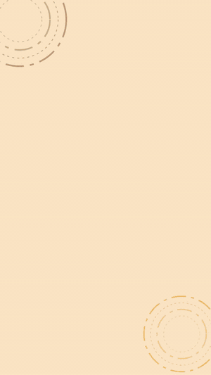
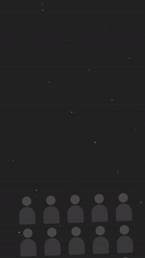
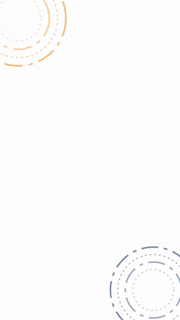

<div dir="rtl">

# سكل الموشن كرافك العربي

سكل للوكلاء الذكية (Claude Code، Cursor، Codex وغيرها) يخليهم يصممون **موشن كرافك بالعربي** بالكود: ريلز، فيديوهات شرح لمنتج أو خدمة، Logo reveal، ونص متحرك. يطلع الفيديو MP4 جاهز للنشر، ويتعامل مع **الـ RTL وتشكيل الحروف العربية** بشكل صحيح.

</div>

**Arabic Motion Graphics Skill** — an agent skill that teaches AI coding agents to build Arabic-first motion graphics (reels, explainers, logo reveals, kinetic typography) as code with Remotion or HTML+GSAP, render them to MP4, and get RTL, Arabic shaping and pacing right.

<!-- Replace with your own renders: assets/explainer.gif, assets/hook.gif, assets/logo.gif -->
<p align="center">
  
  
  
</p>

## Why

Most motion-design skills assume Latin text. Arabic breaks the usual tricks: letter-by-letter animation destroys the joins, `letter-spacing` disconnects letters, motion should flow right-to-left, and numbers, URLs and handles must stay LTR inside RTL layouts. This skill encodes those rules, plus styles, structures and pacing measured from high-performing Arabic reels.

## Install

```bash
npx skills add sudadom/arabic-motion-graphics-skill
```

Or copy `skills/arabic-motion-graphics/` into your agent's skills folder (for Claude Code: `.claude/skills/`).

## What's inside

```
skills/arabic-motion-graphics/
├── SKILL.md                    # workflow: brief → style → storyboard → animate → render → verify
├── references/
│   ├── styles.md               # 3 styles: flat explainer, kinetic collage, heritage/occasion
│   ├── structures.md           # beat sheets with timings for each video type
│   ├── pacing.md               # measured numbers: motion share, holds, transition lengths
│   ├── transitions.md          # 10 transitions: what, when, timing, how to build
│   └── rtl-arabic.md           # shaping, kashida, direction, fonts, digits, safe zones
└── templates/remotion/         # working Remotion project
    └── src/
        ├── components/         # WordByWord, Pill, StepsList, Transitions, BadgePop, EndCard, Decor
        └── demos/              # ExplainerDemo, HookDemo, LogoRevealDemo
```

## Try the templates

```bash
cd skills/arabic-motion-graphics/templates/remotion
npm install
npm run studio          # live preview
npm run render          # explainer → out/explainer.mp4
npm run render:hook
npm run render:logo
```

Fonts (Cairo, Lalezar) are bundled through `@fontsource`, so renders work offline.

## Example prompts

```
اعملي ريل 20 ثانية يشرح تطبيق طلبات لمقهى، بألوان #A15E3E و #E8A33D، وبالنهاية الموقع والإنستغرام
```
```
Make a 15s kinetic hook reel in Iraqi dialect for a design agency, dark background, lime accent
```
```
Logo reveal for "مسار", 4 seconds, navy and orange
```
```
حلل هذي الفيديوهات وسويلي ريل بنفس الأسلوب لمنتجي (بدون نسخ رسوماتهم)
```

## Building blocks

| Component | Does |
|---|---|
| `WordByWord` | RTL word-by-word reveal with spring; highlight keywords |
| `Pill` | capsule label that grows from the right, optional number/icon circle |
| `StepsList` | numbered pills that accumulate 1 → 2 → 3 → 4 (Western or Arabic-Indic digits) |
| `IrisTransition` / `PushTransition` / `DiagonalWipe` / `FadeScale` | scene transitions with tuned durations and easing |
| `BadgePop` | background blur + badge with overshoot, check mark and sparkles |
| `EndCard` | logo → tagline → typed URL → handles → QR, staggered and held |
| `Rings`, `Particles`, `SlowZoom` | secondary motion so holds never look frozen |

## Contributing

Issues and PRs are welcome — especially new Arabic fonts tested for shaping, more transitions, and templates for other dialects and occasions (Ramadan, Eid, national days).

## License

MIT
